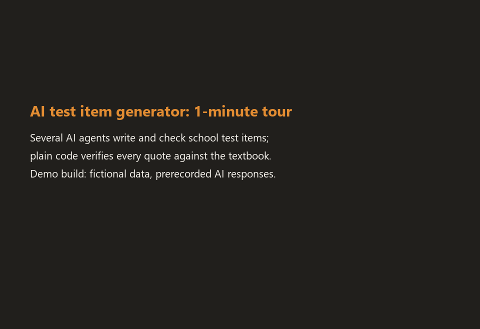
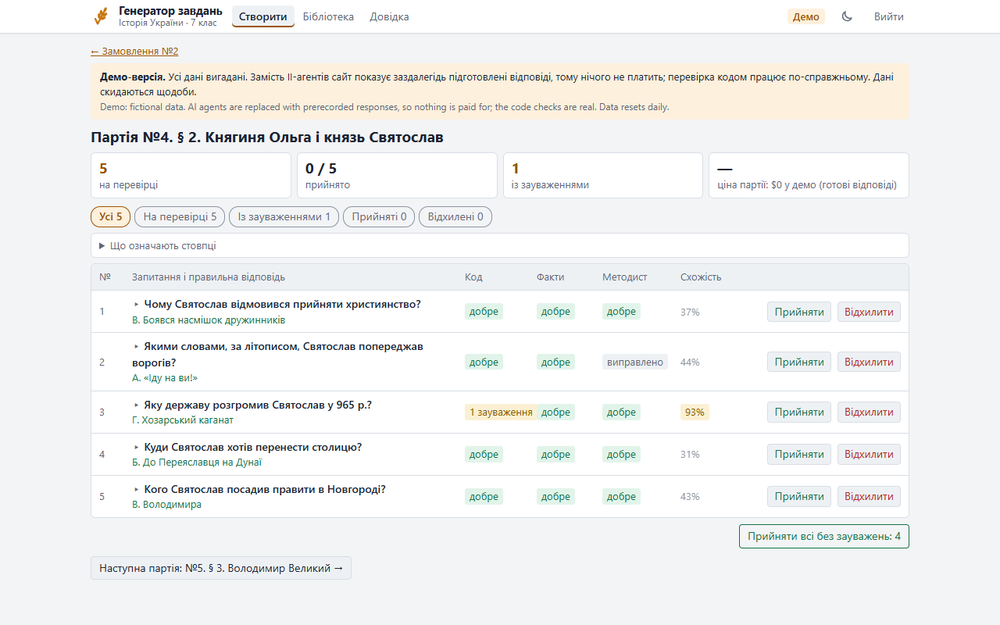
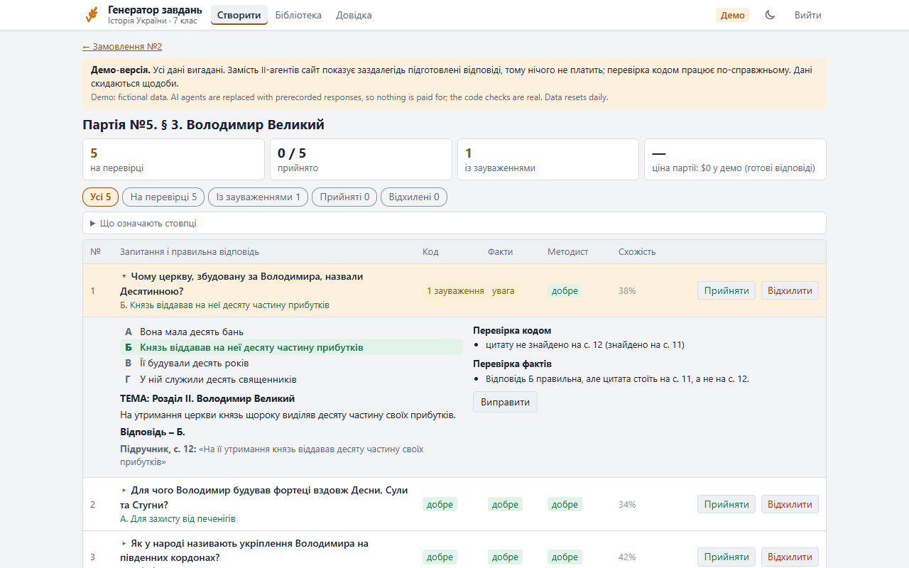
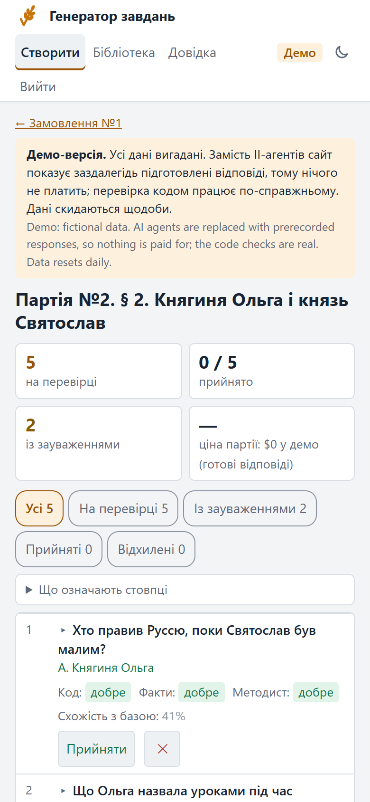
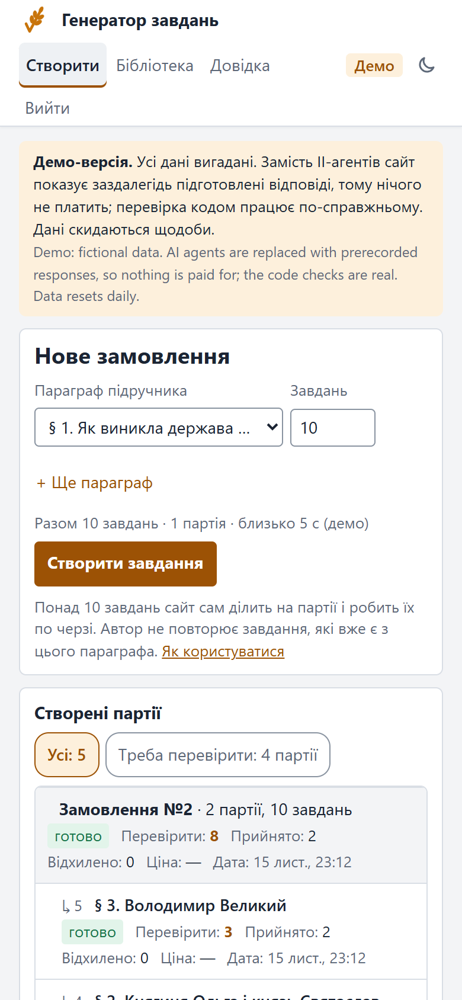
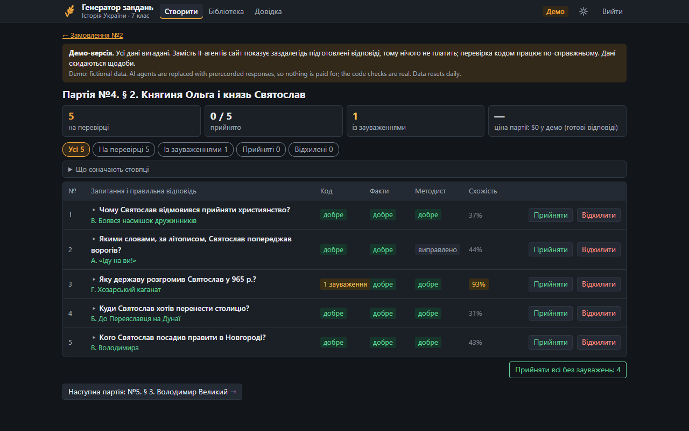
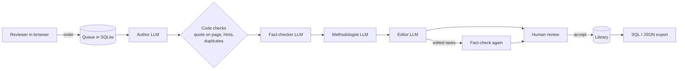
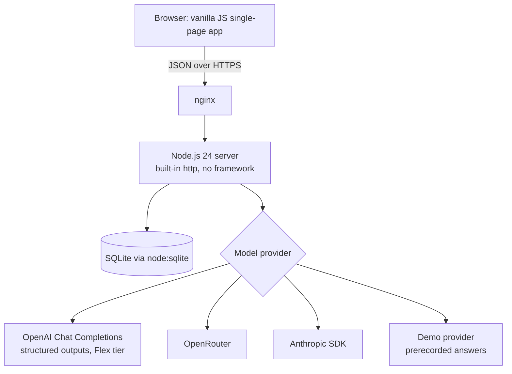

# AI Test Item Generator

**Live demo: https://demo-zno.tutormate.site** · password **`demo`** (shown and pre-filled on the login page)

The demo runs the same code as the production app, but with fictional data and prerecorded AI responses. It costs nothing to run and resets every night.

A web app for a test-prep content team. Several LLM agents write and review multiple-choice history questions for Ukrainian 7th-graders, using one textbook as the only source. Plain code then checks every quote the agents cite against the textbook text and flags near-duplicates of the client's existing question bank. A human reviewer accepts, edits or rejects each item, and accepted items are exported as SQL in the client's table format.

**Status:** a working prototype. Since November 2026 the production instance is used by one client. That instance, its data, the textbook and the client's question bank are private and not in this repository.



| Batch review (desktop) | A task the code check caught |
|---|---|
|  |  |

| Phone | Phone | Dark theme |
|---|---|---|
|  |  |  |

The interface is in Ukrainian on purpose, because the users are Ukrainian teachers. The yellow banner in the demo repeats the key points in English.

## What it does

- **Order tasks:** pick textbook sections and a number of tasks (up to 50 per order). The order is split into batches of up to 10, which run one at a time in a persistent queue.
- **Agent pipeline per batch:**
  1. An **author** agent writes the tasks.
  2. **Code checks** the format and the quotes, and looks for near-duplicates.
  3. A **fact-checker** agent compares each task with the textbook.
  4. A **methodologist** agent judges quality.
  5. An **editor** agent applies the fixes.
  6. Edited tasks are fact-checked again.
- **Code checks without AI:**
  - the cited quote really is on the cited textbook page (and if not, which page it is on);
  - the correct option is not given away (by its length or by a word shared with the question);
  - the task is not too similar to the client's bank, the library or other batches (stemmed-word and character-bigram similarity).
- **Human review:** accept, reject or edit. An edit is re-checked by code.
- **Library and export:** accepted tasks are filtered by section and exported as SQL (or JSON). "Only new" export marks exported tasks.
- **Cost control:** shows the estimated price before an order, a monthly limit checked before the order and before every batch, per-role token accounting, and reconciliation with the OpenAI Costs API.

## How it works





All model providers implement the same four roles (`avtor`, `fakty`, `metodist`, `redaktor`). Every answer is constrained by a JSON Schema. The demo build swaps in a provider that returns prerecorded answers from `demo/otvety/` and never reads API keys.

## Engineering notes

- **Grounding instead of trust.** Every quote is normalised (hyphenation, quotes, spaces) and looked up on the cited page in code, and the page where it really appears is reported. In an early batch the fact-checker agent accepted a "quote" that the author had glued together from two table columns, and only this code check caught it.
- **Not copying the client's bank.** Each question is compared with every item in the bank and in the library using Dice similarity over character bigrams and Jaccard similarity over 6-letter stems. Matches are flagged at 75% for the bank and 80% for the library. The author also receives the questions that already exist for the section.
- **Reliability and cost.**
  - OpenAI Flex tier (half price), with automatic fallback to the standard tier when Flex is busy.
  - Total and silence timeouts, and 3 retries per request.
  - The queue survives restarts.
  - A failed batch can be retried only once, so nobody pays twice.
  - Reconciling with the OpenAI bill showed the app under-counting by about 8%, so the limit now uses the larger of the two numbers.
- **Measured on the private data (not reproducible here):** about 0.5 US cents per accepted task on OpenAI Flex, roughly half the cost through OpenRouter. In blind grading by an LLM judge about 70% of tasks were usable as is; a teacher has not reviewed them yet.

## Tech stack

| Area | What |
|---|---|
| Server | Node.js 24 (built-in `http`, `node:sqlite`, `node:test`), no web framework |
| Frontend | Vanilla JavaScript, HTML, CSS; light and dark themes; phone layout |
| Database | SQLite |
| AI | OpenAI Chat Completions (`gpt-6.1-terra`, Flex tier), OpenRouter, `@anthropic-ai/sdk` ^1.5.0 |
| Infra | Docker (`node:24-alpine`), nginx, Let's Encrypt, Hetzner VPS |
| CI | GitHub Actions: tests on every push |

## Run locally

With Docker:

```bash
docker compose up --build
```

Open http://localhost:8080 and use the password `demo`.

Without Docker, using Node.js 24 (the commands are for bash; on Windows set the variables in PowerShell):

```bash
cd app && npm ci && DEMO=1 DEMO_RESET=1 node server.js
```

Open http://127.0.0.1:8770.

**Real mode:**
1. Copy `app/.env.example` to `app/.env` and add a model API key.
2. Put a textbook in `uchebnik/`: an `index.json` plus `paragrafy/par_NN.txt` with `[стор. N]` page markers.
3. Put an SQL dump of the existing bank in `baza/`.

The `demo/` folder shows the exact formats.

## Tests and CI

- 44 tests written with `node:test`, in `app/tests/`.
- No network and no keys: OpenAI, OpenRouter and Anthropic are replaced with fake HTTP clients.
- **What is covered:**
  - the full pipeline and code checks;
  - retries and the Flex fallback;
  - cost accounting and monthly limits;
  - order splitting and the queue surviving a restart;
  - login, sessions and brute-force lockout;
  - export and the "only new" flag.
- Run them with `cd app && npm test`. GitHub Actions runs the same command on every push.

## Project layout

```
app/server.js        HTTP server, routes, queue
app/lib/cepochka.js  agent pipeline
app/lib/roli.js      roles and JSON Schemas shared by all providers
app/lib/openai.js    OpenAI client (Flex, fallback, pricing)
app/lib/proverka.js  code checks (quotes, hints, duplicates)
app/lib/baza.js      SQL dump parser and similarity
app/lib/demo.js      demo provider and demo seed data
app/public/          single-page frontend
app/tests/           tests
instrukcii/          agent prompts (in Russian)
demo/                fictional textbook, question bank and prerecorded agent answers
```

Identifiers are transliterated Russian, for example `zadanie` = task, `partiya` = batch, `zakaz` = order, `proverka` = check, `uchebnik` = textbook and `baza` = question bank.

## Limitations

- One question type (single choice out of four), one subject, one grade, one textbook.
- One shared password; there are no user accounts or roles.
- Quality has been judged by LLMs, not yet by teachers.
- Model prices are hard-coded.

---

Built with Claude Code; I wrote the specs, reviewed and tested the result.
